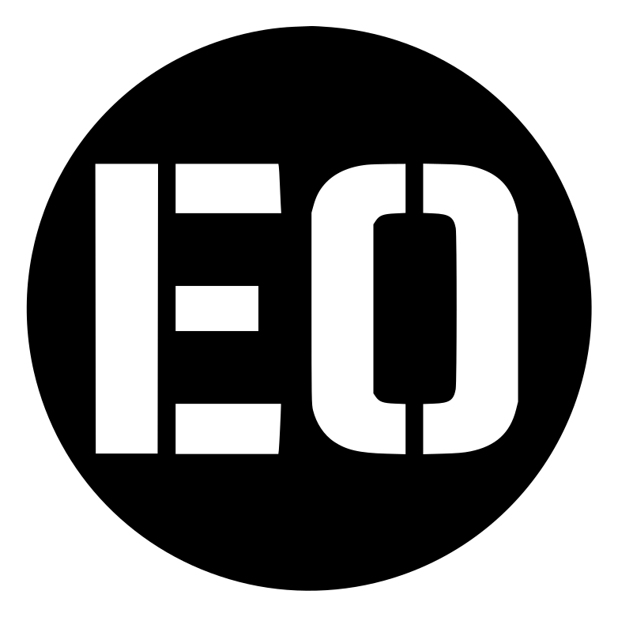
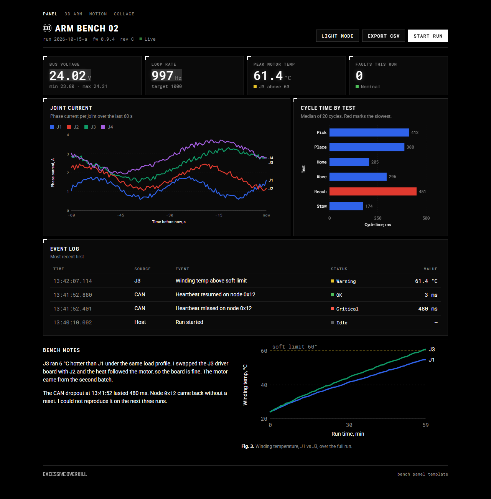
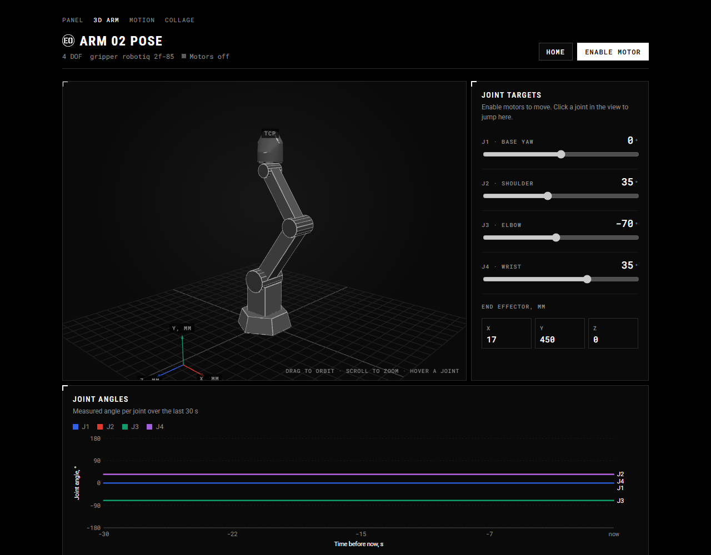
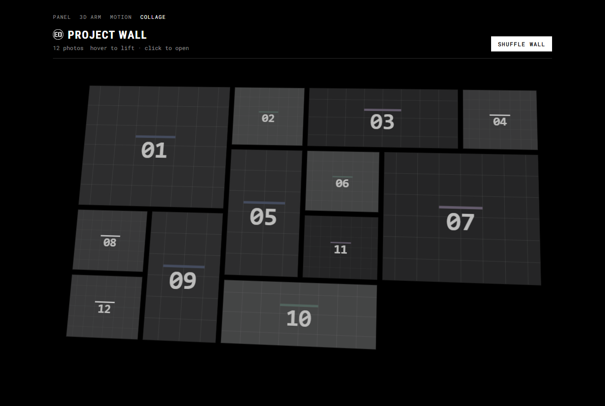
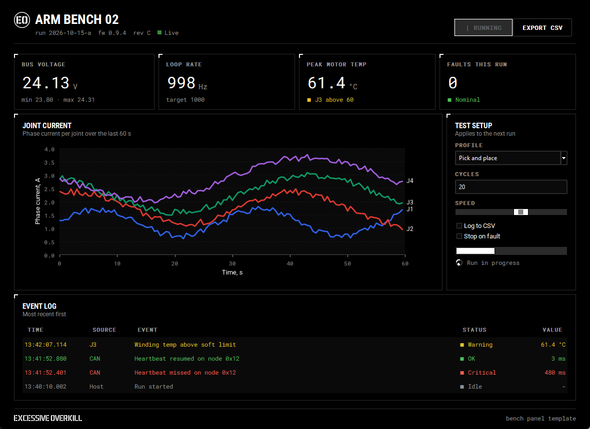
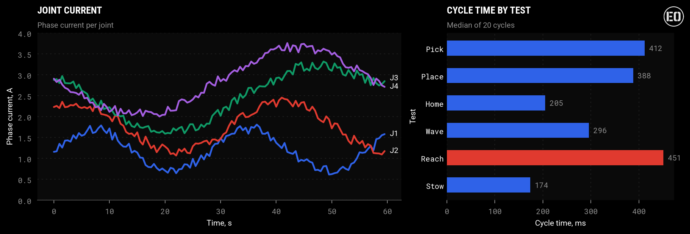

<p align="center"></p>

# eo-style-guide

The Excessive Overkill visual style for test and demo tooling: control panels, charts, 3D viewers, and bench reports. Dark instrument-panel layout, Roboto type, white highlights, dark gray separators, saturated blue/red/green chart colors, the EO mark on every page, and a few small motion touches (a spinner on anything running, a hover effect on each screen's main control, readouts that flash when they change).

It is packaged as a skill so AI coding agents apply it without being reminded, and as plain files you can use with no agent at all.



| 3D arm with live joint control | Photo collage |
|---|---|
|  |  |

Tkinter version of the same panel (`tk/example_panel.py`):



matplotlib output, dark mode:



## What's in it

| Path | What it is |
|---|---|
| `SKILL.md` | The rules an agent reads. Start here if you want to know what the style is. |
| `tokens.json` | Every color, font, size, and logo path in one place |
| `assets/logo/` | EO mark (white and on-light variants, SVG and PNG) and the EXCESSIVE OVERKILL wordmark |
| `web/` | `tokens.css` plus four small scripts: spinners and hover effects, SVG charts, a three.js viewport, an image collage |
| `examples/` | A telemetry panel, a 3D robot arm, a motion demo, and a photo collage |
| `tk/` | `eo_tk.py`, a ttk theme plus EO widgets (Header, Panel, Tile, Status, Spinner, Table), and a full example panel |
| `matplotlib/` | Dark and light style sheets and `eo_style.py` |
| `fonts/` | Roboto, Roboto Condensed, and Roboto Mono (OFL), so matplotlib needs no font install |

To see the examples, serve the folder and open the panel page. The 3D and collage pages load ES modules, so opening the files directly won't work.

```sh
python -m http.server 8791
# then open http://localhost:8791/examples/panel.html
```

## Use it

### Claude Code

Clone it into your skills folder:

```sh
git clone https://github.com/ExcessiveOverkill/eo-style-guide.git ~/.claude/skills/eo-style
```

To make it apply every time, add this to `~/.claude/CLAUDE.md`:

```markdown
## Visual style

Before building or restyling any chart, plot, dashboard, control panel, status page, report, or tool UI, read `~/.claude/skills/eo-style/SKILL.md` and follow it. It overrides any default palette or generic look. If a project already has its own established theme, keep that theme.
```

On Windows the folder is `%USERPROFILE%\.claude\skills\eo-style`.

### Other agents (Codex, Cursor, anything that reads AGENTS.md)

Clone the repo anywhere and point your `AGENTS.md` at it:

```markdown
## Visual style

Before building or restyling any chart, plot, dashboard, control panel, report, or tool UI, read `~/eo-style-guide/SKILL.md` and follow it. Copy files from `~/eo-style-guide/web/` and start from the closest page in `~/eo-style-guide/examples/`.
```

For Cursor, the same text works as a rule in `.cursor/rules/eo-style.mdc` with `alwaysApply: true`.

### No agent

Web: link `web/tokens.css` and `web/ax-fx.js`, put `class="ax"` on `<body>`, and copy pieces from `examples/`. The CSS and JS keep the short `ax` prefix.

Python (matplotlib):

```python
import sys; sys.path.insert(0, "path/to/eo-style-guide/matplotlib")
import eo_style as eo
eo.use("dark")              # or "light" for reports and print
# ... plot, label every axis ...
eo.logo(fig)                # EO mark in the corner; wordmark=True for the full name
eo.save(fig, "out.png")     # refuses to save if any axis is unlabeled
```

Python (tkinter):

```python
import sys; sys.path.insert(0, "path/to/eo-style-guide/tk")
import tkinter as tk, eo_tk as eo

root = tk.Tk()
eo.apply(root, "dark")            # ttk theme, Roboto fonts, EO window icon, dark title bar; "light" for print
head = eo.Header(root, "Servo test", ["run 12", "fw 0.9.4"]); head.pack(fill="x", padx=24, pady=20)
go = eo.button(head.controls, "Start run", kind="primary"); go.pack()
tile = eo.Tile(root, "Bus voltage", "V"); tile.pack(); tile.set(24.13, digits=2)
eo.Footer(root, "bench panel").pack(fill="x", side="bottom")
root.mainloop()
```

Everything else is plain `ttk` (Entry, Combobox, Scale, Checkbutton, Notebook, Treeview) and picks up the theme automatically. Helpers: `eo.busy(btn, True, "Homing")` for a running button, `eo.Spinner`, `eo.Status` (square plus word, `live` breathes), `eo.Table` (hover rows), `eo.embed_figure()` for matplotlib charts, `eo.px()` for DPI-scaled sizes. Run `python tk/example_panel.py` to see all of it. On Windows the bundled Roboto fonts load automatically; elsewhere install them from `fonts/` or Tk falls back to system fonts.

## Branding

- The EO mark leads every page title (`h1`), drawn as a CSS mask in the accent color. `<span class="ax-logo"></span>` places it anywhere; add `ink` for the text color.
- The wordmark goes in the footer: `<footer class="ax-foot"></footer>`. Light mode inverts it automatically.
- matplotlib figures get the mark with `eo.logo(fig)`.

Brand colors are black, white, and dark gray, matching the logos. The accent is white (black in light mode), so the only hue in any screen comes from chart series and status colors. To change anything, edit `tokens.json` first, then copy the values into `web/tokens.css`, `matplotlib/eo_style.py`, both `.mplstyle` files, and `tk/eo_tk.py`. Check new chart colors for colorblind separation before you commit to them (Anthropic's dataviz skill ships a `validate_palette.js` for this).

## Credits and license

Based on [alexchunlin/alex-style-guide](https://github.com/alexchunlin/alex-style-guide) (MIT). Code and docs are MIT, with both copyright lines kept in `LICENSE`. Fonts are under the SIL Open Font License (`fonts/OFL.txt`). The gripper mesh in `examples/assets/` is from Robotiq's ROS description package (BSD 3-Clause); see `examples/assets/ATTRIBUTION.md`. The EO logos and wordmark are not covered by the MIT license; all rights reserved by Excessive Overkill.
